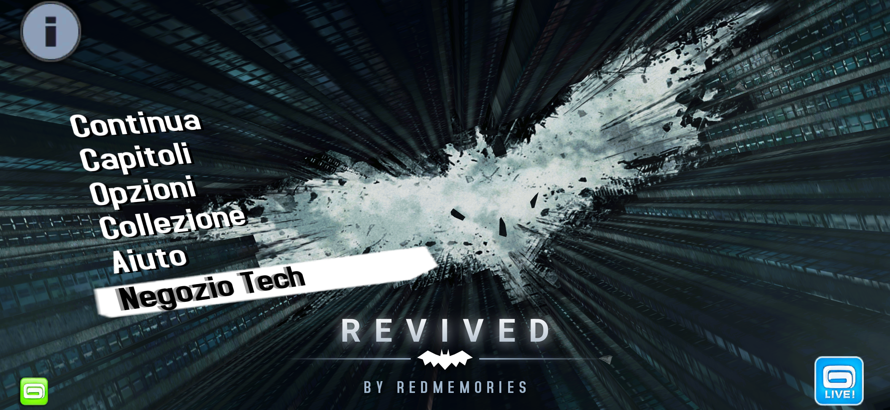
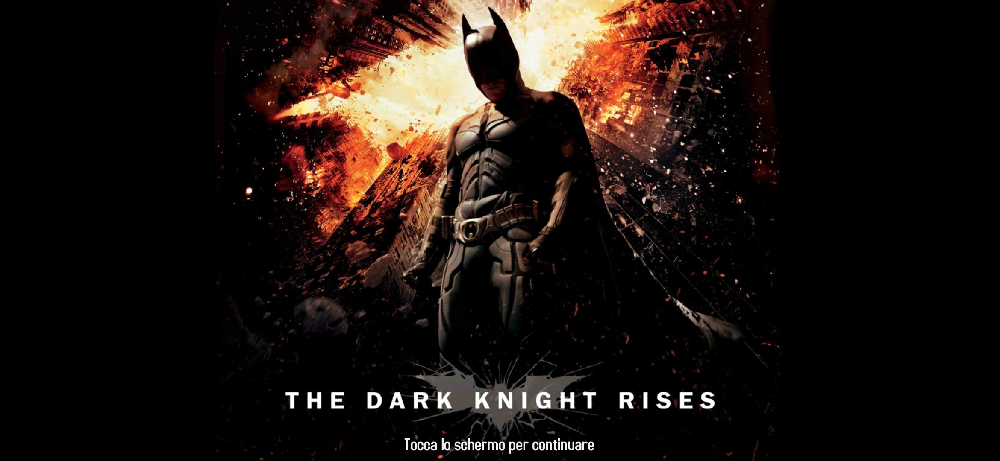
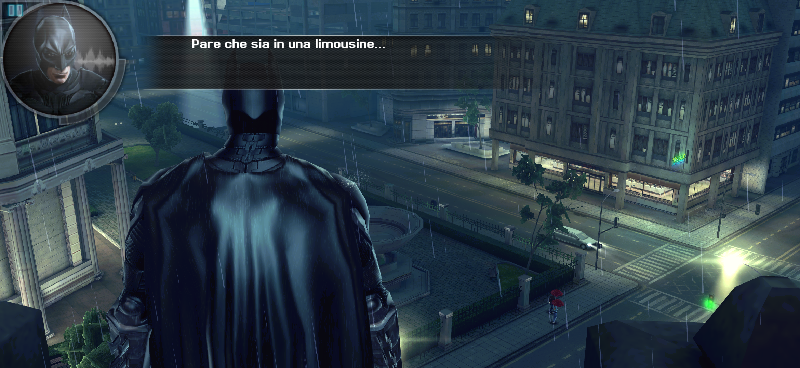

# The Dark Knight Rises Revived

[](screenshots/main-menu.png)

> Batman and all related characters are trademarks of DC Comics. The Dark Knight Rises mobile game is by Gameloft. This is a non-commercial fan project, not affiliated with DC, Warner Bros. or Gameloft. The game was pulled from the stores years ago. This repo is my private archive, please don't share the release files.

## What I did

I didn't remake the game and I didn't touch the gameplay. Gotham, the missions and the story are exactly the ones from 2012.

As with The Amazing Spider-Man 2 and Spider-Man Total Mayhem, I recompiled the whole engine to 64-bit code ahead of time: 39,153 of its 39,158 functions, rebuilt for today's phones. While you play, every call in the engine runs in the recompiled code, so the game runs as a modern app.

This one needed more work before it could even start. The only copy I could find had been repackaged by a third-party store. The store had added a full-screen ad before the game, and in the process about a quarter of the game's Java code had been overwritten with garbage, so the game couldn't run on a modern phone. I rewrote the whole Android side of the game from scratch, using the intact code of another release as a reference, and removed everything the repackager had added.

[](screenshots/title-screen.png)

Once it was running:

- full screen on today's tall displays, at the full resolution of the screen
- runs smoothly, close to 60 fps
- the game data lives in the app's own folder, so the game doesn't need access to your storage, doesn't read your phone's ID anymore and doesn't ask for any permission
- the game data is packed inside the APK, so there's nothing to download separately

[](screenshots/gotham-rooftop.png)

## Install

1. Download the APK from **Releases**
2. Install it
3. Open it. The first launch takes a few seconds to unpack the game, after that it starts right away

No PC, no extra downloads, no account.

## Requirements

- 64-bit Android phone with Android 10 or newer
- about 3 GB of free space

I play it on a Galaxy S26 Ultra with Android 17. I haven't tried it on phones without a Snapdragon chip yet (MediaTek Dimensity, Exynos, Google Tensor): if you play on one of them, let me know how it runs.

## Credits

Revived by **RedMemories**

Thanks to the [dynarmic](https://github.com/azahar-emu/dynarmic) project: its ARM decoder is the base of the recompiler, and it still runs the few bits of the engine that aren't recompiled.

Original game by Gameloft.

## ☕ Support my work

If you enjoy my projects and would like to support my work, you can send a tip in **USDC on the Polygon network**. Every project I create is and will always remain free, but any support is greatly appreciated and helps me keep working on new projects and improvements.

```
0x0e1C11ccA29E9D2AAa9384eE0d5464f4d079E61D
```

⚠️ Send only **USDC on Polygon** to this address: other tokens or networks could be lost.

Thank you for your support! ❤️
